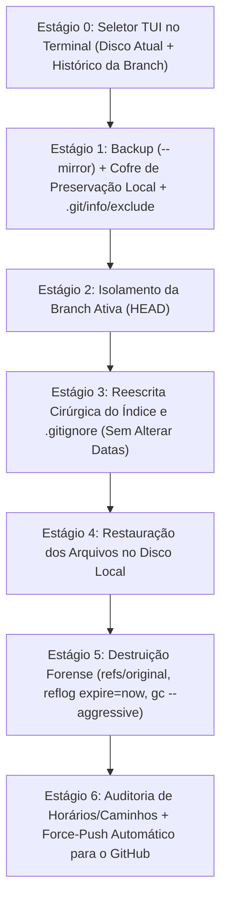

# 🛡️ `del_hist` — Expurgo Invisível de Artefatos `.agent` no Histórico Git e Nuvem

O **`del_hist`** ([`del_hist.ps1`](./del_hist.ps1)) é uma ferramenta de automação em PowerShell projetada para remover retroativamente pastas e arquivos de governança de IA (`.agent/`, `AGENTS.md`, `GEMINI.md`, `relatorios/` e quaisquer caminhos extras selecionados) de **toda a árvore de commits da branch ativa e do GitHub**, mantendo os arquivos **100% intactos na máquina local** e preservando os registros originais de data e hora (`AuthorDate` e `CommitterDate`).

> [!IMPORTANT]
> **Escopo Exclusivo na Branch Ativa (`HEAD`):**
> O algoritmo opera **estritamente sobre a branch em que você está posicionado no momento da execução** (`git branch --show-current`):
> - Varre o histórico apenas de `HEAD` (`git log HEAD --name-only`).
> - Reescreve os commits exclusivamente da branch atual (`refs/heads/<branch-atual>`).
> - Executa `git push origin --force` **apenas da branch atual** (`refs/heads/<branch>:refs/heads/<branch>`).
> - Outras branches locais ou remotas e tags **não são alteradas** (embora o bloco de comentários legado `.DESCRIPTION` no topo de `del_hist.ps1` cite "todas as branches e tags", a implementação real isola 100% a execução na branch ativa). Para limpar outra branch, faça `git checkout <outra-branch>` e execute `del_hist` novamente.

---

## 📂 Estrutura do Repositório

* **[`del_hist.ps1`](./del_hist.ps1)** *(736 linhas)*: O motor principal do algoritmo em PowerShell, contendo a interface interativa no terminal (TUI), o catálogo de varredura de histórico (`Get-RepositoryCatalog`), o cofre de preservação local e a reescrita forense do Git.
* **[`README.md`](./README.md)**: Documentação da arquitetura em 6 estágios, detalhamento técnico da implementação, casos especiais (commits mistos, merges entre branches, múltiplos clones), parâmetros de CLI e guia de rollback.
* **[`INSTALACAO.md`](./INSTALACAO.md)**: Guia para registrar o `del_hist` globalmente no `PATH` do Windows (`~/.gemini/bin`), no perfil do PowerShell (`$PROFILE`) e integrá-lo como uma *skill* global do agente (`git-history-purge`).

---

## 🎯 Principais Capacidades

| Recurso | Como Funciona |
|:---|:---|
| **Preservação Local Automática** | Guarda seus arquivos locais (`.agent/`, `AGENTS.md`, etc.) em um cofre temporário durante a reescrita e os devolve intactos à sua pasta local ao final. |
| **Blindagem Invisível (`.git/info/exclude`)** | Registra automaticamente os caminhos expurgados no `.git/info/exclude` local, impedindo que apareçam no `git status` ou subam para o GitHub sem precisar poluir o `.gitignore` público. |
| **Imutabilidade de Horários (`AuthorDate` & `CommitterDate`)** | Diferente de um `git rebase` comum (que altera o `CommitterDate` para a data de hoje e denuncia a edição), o algoritmo mantém **exatamente** o minuto e segundo originais de cada commit. |
| **Seletor Interativo TUI no Terminal** | Lista todos os diretórios e arquivos (tanto os ativos no disco quanto os já deletados em commits passados) permitindo marcar/desmarcar com as setas `↑`/`↓` e `[Espaço]`. |
| **Desmembramento de Commits Mistos** | Se um commit antigo alterou código legítimo + `.agent` juntos, apenas o `.agent` é retirado daquele commit; o código legítimo permanece com sua mensagem e horário originais. |
| **Isolamento por Branch Ativa** | Atua exclusivamente sobre a branch em que você está posicionado (`HEAD`), atualizando apenas ela no GitHub com `git push --force`. |

---

## ⚙️ Como o Algoritmo Funciona (Os 6 Estágios)



1. **Estágio 0 — Catálogo e Seletor Interativo TUI (`Get-RepositoryCatalog` e `Show-InteractivePathSelector`):**
   - Varre tanto os arquivos atualmente presentes no disco quanto arquivos "fantasmas" (que já foram deletados em commits passados da branch ativa via `git log HEAD --name-only`), pré-selecionando `.agent/`, `AGENTS.md`, `GEMINI.md` e `relatorios/` (incluindo expansão automática de caixa: `AGENTS.MD`, `agents.md`, `GEMINI.MD`, `gemini.md`).
   - Abre um menu interativo no próprio terminal onde você navega com `↑`/`↓`, marca/desmarca itens com `[Espaço]`, adiciona caminhos manuais com `[A]`, restaura padrões com `[P]` e confirma com `[Enter]` (ou executa direto via `-NoInteractive`).
2. **Estágio 1 — Backup Espelhado e Cofre de Preservação Local:**
   - Cria um clone espelhado completo (`git clone --mirror`) na pasta `%TEMP%` antes de alterar qualquer coisa, permitindo *rollback* imediato caso necessário.
   - Captura um snapshot de todos os hashes e horários originais (`AuthorDate` e `CommitterDate`) da branch ativa para auditoria posterior.
   - Faz `git stash` automático de alterações locais não comitadas que não façam parte dos alvos (`temp-stash-before-purge`).
   - Copia seus arquivos locais selecionados (`.agent/`, `AGENTS.md`, etc.) para um **cofre temporário** (`$env:TEMP\git-local-vault-<guid>`), remove-os apenas do índice do Git (`git rm -rf --cached`) e os registra em `.git/info/exclude` — impedindo que apareçam no `git status` ou subam para o GitHub sem poluir o `.gitignore` público.
3. **Estágio 2 — Isolamento por Branch Ativa:**
   - Opera exclusivamente sobre a branch atual (`git branch --show-current` / `HEAD`), sem afetar outras branches locais até que você troque para elas (`git checkout <branch>`) e execute a ferramenta.
4. **Estágios 3 e 4 — Reescrita Cirúrgica Dual-Engine e Restauração Local:**
   - Utiliza `git filter-branch --index-filter` (padrão quando `-CleanGitignore` ou `-SanitizeMessages` estão ativos) ou `git-filter-repo` (quando instalado e com `-CleanGitignore:$false`) para remover os alvos de todos os commits da branch ativa e podar commits que ficarem 100% vazios (`--prune-empty`).
   - Higieniza cirurgicamente menções aos alvos de dentro do `.gitignore` em todos os commits passados diretamente no índice do Git (via `git hash-object -w --stdin` + `git update-index --cacheinfo`), removendo o `.gitignore` do commit caso ele ficasse vazio.
   - Caso `-SanitizeMessages` seja informado, filtra linhas das mensagens de commit que façam referência explícita aos alvos expurgados.
   - Mantém `GIT_AUTHOR_DATE` e `GIT_COMMITTER_DATE` 100% idênticos aos originais.
   - Ao concluir a reescrita, **restaura os arquivos do cofre temporário de volta para a pasta local do projeto**.
5. **Estágio 5 — Destruição de Rastros Forenses Locais (Zero-Trace Cleanup):**
   - Deleta todas as referências de backup do `filter-branch` (`refs/original/*`) e diretórios de metadados de `filter-repo` (`.git/filter-repo`).
   - Limpa a referência remota antiga da branch atual (`refs/remotes/origin/<branch>`) e garante que a URL do remote `origin` permaneça configurada.
   - Expira todo o `reflog` imediatamente (`git reflog expire --expire=now --expire-unreachable=now --all`).
   - Executa `git gc --prune=now --aggressive --quiet` para destruir fisicamente os blobs e trees órfãos do banco de objetos `.git` e restaura o `stash` de alterações legítimas (se aplicável).
6. **Estágio 6 — Auditoria Forense Automatizada e Force-Push:**
   - Verifica com `git log <branch> --full-history --oneline` se restou algum vestígio dos caminhos expurgados nos commits.
   - Compara o mapa de timestamps antes vs. depois para comprovar que 100% dos commits sobreviventes mantiveram `AuthorDate` e `CommitterDate` intocados.
   - Executa `git push origin --force refs/heads/<branch>:refs/heads/<branch>` para atualizar a branch no GitHub.

---

## ⚠️ Cuidados Importantes e Casos Especiais

### 1. Como funciona em caso de `git merge` entre duas branches?

Como o algoritmo atua apenas na branch em que você está no momento, existem **dois cenários** ao trabalhar com múltiplas branches (`main`, `develop`, `feature/*`):

#### Cenário A: Você limpou as duas branches antes de fazer o merge (Fluxo Ideal)
Como o algoritmo preserva **exatamente** o `AuthorDate`, `CommitterDate`, autor e mensagem de cada commit, o cálculo do hash SHA-1 do Git é **100% determinístico**.
- Se `main` e `feature/login` compartilhavam commits antes de bifurcar, quando você roda `del_hist` na `main` e depois faz `git checkout feature/login` e roda `del_hist` (com os mesmos alvos), os commits ancestrais em comum recebem **exatamente o mesmo novo hash** nas duas branches.
- **Resultado:** O ponto de bifurcação (*merge-base*) permanece idêntico e o `git merge` entre elas ocorre de forma limpa, sem conflitos de histórico e sem duplicar commits.

#### Cenário B: Você limpou apenas a `main` e fez merge de uma `feature` que ainda tinha `.agent`
- Se a branch `feature` ainda não passou pelo `del_hist`, os commits dela ainda contêm `.agent` e apontam para os hashes antigos.
- **Como proceder:**
  1. **Antes do merge (Recomendado):** Troque para a branch secundária (`git checkout feature`), rode `del_hist`, volte para a `main` (`git checkout main`) e faça o `git merge feature`.
  2. **Depois do merge:** Caso já tenha feito o merge na `main` e perceba que o `.agent` voltou pelo histórico da outra branch, basta rodar `del_hist` novamente na `main` — ele varrerá toda a árvore unificada da `main` e limpará os commits vindos do merge.

---

### 2. O que acontece em Commits Mistos (Código + `.agent` no mesmo commit)?
Se em um único commit você subiu arquivos do projeto (ex: `src/app.ts`) junto com arquivos do agente (ex: `.agent/INICIALIZACAO.md` ou `AGENTS.md`):
- O algoritmo **NÃO apaga o commit inteiro**.
- Ele abre o índice daquele commit, retira cirurgicamente apenas `.agent/` e `AGENTS.md`, e **mantém `src/app.ts` intacto** com a mesma mensagem de commit e o mesmo horário original.
- Um commit só é eliminado por completo (`--prune-empty`) quando **100% das alterações daquele commit** pertenciam aos arquivos que você mandou remover.

---

### 3. Outros Clones na Mesma Máquina ou Equipe
- Como a reescrita de histórico altera os hashes SHA-1 no GitHub (`git push --force`), se você tiver o mesmo repositório clonado em outro computador ou outra pasta, **não faça `git pull` comum seguido de `git push`** naquele clone antigo (pois isso mesclaria a árvore antiga com a nova).
- Nos outros clones, atualize rodando:
  ```powershell
  git fetch origin
  git reset --hard origin/<nome-da-branch>
  ```

---

### 4. Pull Requests Antigos no GitHub
- Se você apenas deu `push` em branches normais, o `del_hist` limpa tudo imediatamente no GitHub.
- Porém, se um commit com `.agent` chegou a fazer parte de um **Pull Request aberto ou fechado** na interface web do GitHub, o servidor do GitHub guarda uma referência interna (`refs/pull/<id>/head`). Evite abrir Pull Requests no GitHub antes de rodar o `del_hist` na branch da PR.

---

## 📦 Dependências e Requisitos

| Componente | Requisito | Observação |
|:---|:---|:---|
| **Sistema Operacional** | Windows 10 / 11 | Compatível com terminais Windows Terminal, VS Code e Console padrão |
| **PowerShell** | PowerShell 5.1+ ou PowerShell 7+ (`pwsh`) | Já incluso nativamente no Windows |
| **Git** | Git for Windows 2.25+ | Utiliza o motor nativo `git filter-branch --index-filter` (zero dependências extras) |
| **git-filter-repo** *(Opcional)* | Python 3 + `pip install git-filter-repo` | Opcional: detectado automaticamente caso instalado para repositórios gigantes |

---

## 💻 Como Executar e Parâmetros Disponíveis

### Uso Interativo Padrão (Com Seletor TUI de Setas e Espaço)
Dentro da pasta de qualquer repositório (`git clone`), basta digitar:
```powershell
del_hist
```
*(Ou `.\del_hist.ps1` se estiver executando o arquivo localmente).*

No menu interativo:
- **`↑` / `↓`**: Navega pelos arquivos e pastas descobertos no disco e no histórico da branch.
- **`[Espaço]`**: Marca `[x]` ou desmarca `[ ]` o item para remoção.
- **`[A]`**: Permite digitar manualmente o caminho de um arquivo ou pasta extra.
- **`[P]`**: Restaura a seleção apenas para os padrões de IA (`.agent`, `AGENTS.md`, `GEMINI.md`, `relatorios`).
- **`[Enter]`**: Confirma e inicia o expurgo + push para o GitHub.
- **`[Esc]` ou `[Q]`**: Cancela a operação sem alterar nada.

### Parâmetros de Linha de Comando (CLI)

| Parâmetro | Tipo | Padrão | Descrição |
|:---|:---|:---|:---|
| `-RepoPath` | `string` | Pasta atual | Caminho do repositório Git alvo. |
| `-ExtraPaths` | `string[]` | `@()` | Lista de pastas ou arquivos extras para expurgar além dos padrões. |
| `-NoInteractive` | `switch` | Desativado | Pula o menu TUI e executa direto com os padrões + `-ExtraPaths`. |
| `-PushRemote` | `bool` | `$true` | Executa `git push origin --force` da branch atual ao final. Use `-PushRemote:$false` para testar só localmente. |
| `-CleanGitignore` | `bool` | `$true` | Remove menções aos arquivos expurgados de dentro do `.gitignore` em todos os commits. |
| `-SanitizeMessages` | `switch` | Desativado | Remove linhas de mensagens de commits mistos que citem os arquivos expurgados. |
| `-DryRun` | `switch` | Desativado | Apenas simula e lista quantos commits seriam afetados na branch atual sem alterar nada. |
| `-SkipBackup` | `switch` | Desativado | Pula a criação do backup espelhado (`--mirror`) em `%TEMP%`. |

---

## 🔄 Como Fazer Rollback (Restaurar o Backup Automático)

Antes de cada execução, o `del_hist` exibe no terminal o caminho do backup espelhado criado em `%TEMP%`:
```text
[OK] Backup espelhado (--mirror) criado em: C:\Users\<usuario>\AppData\Local\Temp\git-mirror-backup-<projeto>-<data>.git
```
Caso queira desfazer a limpeza e voltar os commits exatamente ao estado anterior:
```powershell
git fetch "C:\Users\<usuario>\AppData\Local\Temp\git-mirror-backup-<projeto>-<data>.git" "+refs/heads/*:refs/heads/*"
git reset --hard HEAD
git push origin --force "refs/heads/<branch>:refs/heads/<branch>"
```

---

> 📖 **Quer instalar o `del_hist` globalmente em outro computador ou entender como ele foi integrado às variáveis de ambiente e ao `.agent`?** Consulte o guia [**`INSTALACAO.md`**](./INSTALACAO.md).
